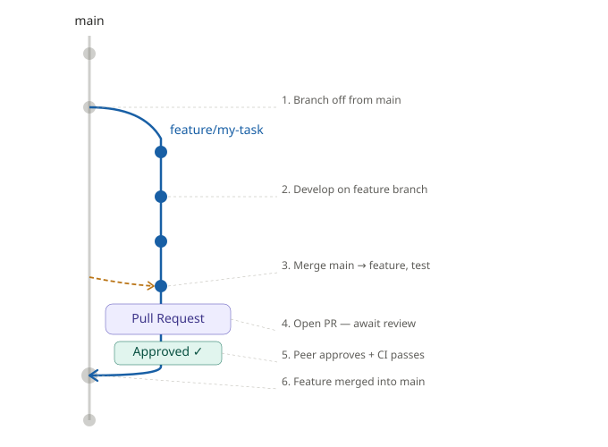

# GAIA Explorer

## Branching & Contribution Strategy

### Overview

All development happens on **feature branches**. The `main` branch is always stable and production-ready. Direct commits to `main` are **not allowed** — all changes must go through a pull request, which will be reviewed and approved by another team member.

---

### Branch Structure

- `main` — stable, always deployable
- `feature/<short-description>` — one branch per task or feature

---

### Workflow

### 1. Create a feature branch

Always branch off from `main`:

```bash
git checkout main
git pull origin main
git checkout -b feature/<your-task-name>
```

### 2. Develop on your feature branch

Do all your work here. Commit changes with short and descriptive commit messages.

### 3. Before opening a PR — sync with main

Before creating a pull request, merge the latest `main` into your feature branch and verify everything still works:

```bash
git checkout main
git pull origin main
git checkout feature/<your-task-name>
git merge main
```

Resolve any conflicts, test your changes, and only then proceed.

### 4. Open a Pull Request

Push your branch and open a PR against `main` on GitHub. Prefferably, write a clear description of what was done and why.

### 5. Do not merge your own PR

A pull request must be **reviewed and approved by at least one other team member** before merging. Never approve or merge your own PR.

### 6. CI must pass

A pull request will **not be approved if the build or tests fail**. Fix any issues before requesting a review.

### 7. Merge

Once approved and CI passes, the reviewer (or the author — but not both) merges the PR into `main`.



## Project progress
| Progress | Task | Deadline | Output | Comments |
|:---:|---|---|---|---|
| **Work package 1** | | | | |
| DONE | Gaia data reading and analysis | April 2026 | Report on Gaia data attributes, availability, volume, consistency, and distribution | Reading, analyzing, and understanding the Gaia dataset. |
|  | Encoding and compression | February 2027 | Data preprocessing pipeline |Developing an efficient encoding scheme and compression techniques to reduce data size while maintaining rendering performance. |
|  | Hierarhical level-of-detail representation | August 2027 | Data preprocessing pipeline | Designing a hierarchical structure for the dataset to allow multi-resolution rendering, enabling efficient data retrieval and visualization at different scales. |
| **Work package 2** | | | | |
| In progress | Server setup and configuration | February 2027 | Server stack and configuration | Set up and configure the backend server infrastructure, ensuring scalability and reliability.
| In progress | Data access and streaming | May 2027 | Data access API | Implement an API to allow efficient data access and streaming of astronomical data in real-time. |
| **Work package 3** | | | | |
|  | Technology review | June 2026 | Report on technology review and selection | Review existing web technologies and frameworks for high-performance 3D rendering and data visualization. |
|  | Developing the rendering engine | August 2027 | Rendering engine | Develop an efficient web-based rendering engine capable of handling the Gaia dataset interactively.  |
|  | User interaction | November 2027 | User interface and interaction | Design and implement user interaction tools, such as data filtering, entity grouping, coloring and sparsification, to enhance data exploration. |
| **Work package 3** | | | | |
| In progress | Management | February 2028 | Reports on meetings with ESA and Heidelberg, Dissemination | Management of the project, communication with ESA, submitting documents and reports to ESA. |

**Milestones reference**
- **MS1 – Kickoff** (M0 - March 2026)
- **MS2 – Data preprocessing pipeline established** (M7 - September 2028)
- **MS3 – Base functionalities developed and deployed** (M18 - August 2027)
- **MS4 – Application fully developed and deployed** (M24 - Februar 2028)

---

### WP 1 — Data preparation and preprocessing

#### Task 1.1: Gaia data reading and analysis
**Target: MS2** — full execution of data analysis and reading is required for this milestone.
- [ ] Study the Gaia catalog schema (tables, columns, data types, data releases)
- [ ] Analyze total data volume and storage
- [ ] Analyze spatial distribution, data structures and variability characteristics within the dataset.
- [ ] Identify relevant data subsets/attributes needed for visualization
- [ ] Investigate consistency across different Gaia data releases
- [ ] Define a strategy for handling missing, corrupted, or uncertain data
- [ ] Establish efficient access patterns for real-time visualization use
- [ ] Write report **D1.1**: Gaia data attributes, availability, volume, consistency, distribution

### Task 1.2: Encoding and compression
**Target: MS2** — groundwork/foundation expected by this milestone (full pipeline integration continues afterward).

- [ ] Research existing encoding/compression techniques for large-scale data
- [ ] Shortlist candidate formats
- [ ] Prototype and benchmark compression ratio
- [ ] Benchmark decompression speed to confirm it stays lightweight for real-time use
- [ ] Select final encoding/compression scheme
- [ ] Integrate encoding step into the data preprocessing pipeline

### Task 1.3: Hierarchical level-of-detail representation
**Target: begins at MS2, finished until MS3**.

- [ ] Research hierarchical/spatial indexing structures (octree, HEALPix, k-d tree, etc.)
- [ ] Design a hierarchy suited to Gaia
- [ ] Implement the algorithm that builds the hierarchy from processed data
- [ ] Implement dynamic loading of data subsets based on current view
- [ ] Optimize the hierarchy for retrieval speed and memory footprint
- [ ] Finalize and document the full pipeline

---

## WP 2 — Web application backend

### Task 2.1: Server setup and configuration
**Target: MS3** — backend (WP2) finalized, incl. deliverable **D2.2**.

- [x] Choose hosting/infrastructure
- [ ] Set up server environment and required dependencies
- [x] Configure storage/database for preprocessed Gaia data
- [ ] Configure server for scalability (load balancing / horizontal scaling)
- [ ] Stress-test the server under varying load conditions
- [ ] Document server stack and configuration

### Task 2.2: Data access and streaming
**Target: MS3** — backend (WP2) finalized, incl. deliverable **D2.3**.

- [ ] Design API endpoints for data access
- [ ] Implement caching of data used for visualization
- [ ] Implement caching of data used for analysis
- [ ] Implement range-based queries leveraging the hierarchical LOD structure
- [ ] Implement incremental/streaming data loading
- [ ] Optimize API for high-performance querying
- [ ] Implement API calls queuing
- [ ] Test API under real-time streaming conditions
- [ ] Document the finished API

---

## WP 3 — Web application frontend

### Task 3.1: Technology review
**Target: MS2** — should be completed by this milestone, independent of WP2 progress.

- [ ] Review existing web technologies and frameworks (WebGPU, WebGPU 2.0)
- [ ] Evaluate libraries: Three.js, Babylon.js, and alternatives
- [ ] Assess fallback strategies for devices without WebGPU support
- [ ] Compare performance/feature trade-offs across options
- [ ] Select final technology stack

### Task 3.2: Developing the rendering engine
**Target: fully functional by MS3**.

- [ ] Set up the rendering engine project using the selected stack
- [ ] Integrate data loading with the backend API
- [ ] Asses and Implement high-performance rendering techniques, which will support millions of data points (such as instancing, multiple levels of detail, and hardware
occlusion culling)
- [ ] Implement adaptive resolution for different device capabilities
- [ ] Test performance across desktop and mobile browsers
- [ ] Verify compatibility across relevant web standards/frameworks

### Task 3.3: User interaction
**Target: basic interaction by MS3**, full interaction tools by **MS4**.

- [ ] Define interaction requirements (filtering, grouping, coloring, sparsification)
- [ ] Implement data filtering tools
- [ ] Implement entity grouping functionality
- [ ] Implement coloring/visual encoding controls
- [ ] Implement data sparsification controls
- [ ] Implement touch gesture support for mobile users
- [ ] Implement overlay/annotation features
- [ ] Conduct user testing sessions
- [ ] Refine interaction mechanics based on feedback
- [ ] Deliver **D3.3**: User interface and interaction

---

## WP 4 — Management

### Task 4.1: Management
**Ongoing across all milestones**.

---